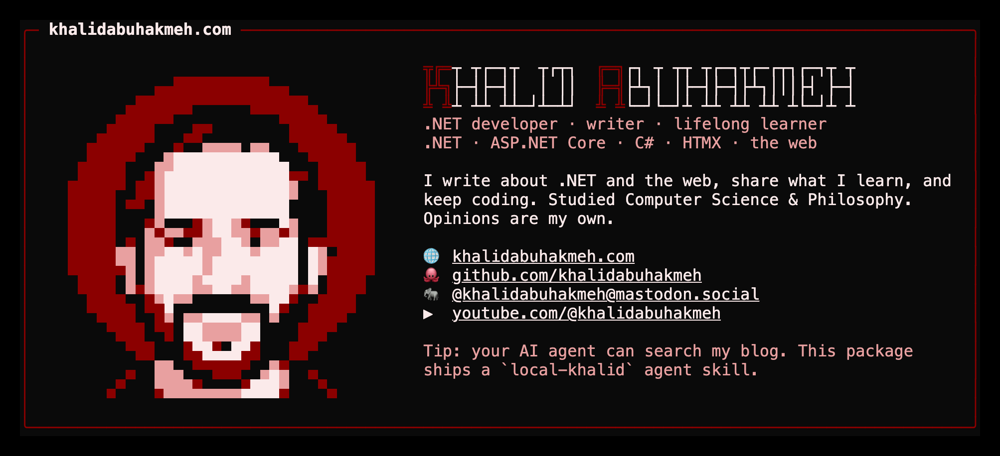

# Khalid.Abuhakmeh

A small, fun, branded package from [Khalid Abuhakmeh](https://khalidabuhakmeh.com). It ships two things:

1. **`Khalid.Hello()`**: prints a [Spectre.Console](https://spectreconsole.net) calling card with an ASCII avatar, a short bio, and clickable links.
2. **A `local-khalid` agent skill**: lets your AI agent (GitHub Copilot, Claude Code, and others) find Khalid's blog posts that are relevant to the problem you are working on.

## Install

```bash
dotnet add package Khalid.Abuhakmeh
```

Targets `netstandard2.0` and `net8.0`. The only dependency is Spectre.Console.

Versions are dates, not SemVer: `2026.11.19` means a package built on 19 November 2026 (UTC), and a newer date is a newer package. A second release on the same day gets a fourth segment (`2026.11.19.1`). The public API is tiny and stable; what changes between releases is the bundled post index.

## Usage

```csharp
using Abuhakmeh;

Khalid.Hello();
```

The namespace is `Abuhakmeh` and the class is `Khalid` on purpose, so `Khalid.Hello()` does not collide with the package namespace.

Or as a single-file app (.NET 10):

```csharp
#:package Khalid.Abuhakmeh@*

using Abuhakmeh;

Khalid.Hello();
```

```bash
dotnet run app.cs
```

For tests or custom consoles, pass an `IAnsiConsole`:

```csharp
Khalid.Hello(console, new CallingCardOptions(Color: false, Compact: true));
```

The card switches to a compact layout (no avatar) on consoles narrower than 80 columns, a monochrome ASCII avatar when color is off, and ASCII borders and labels when Unicode is not available. The panel has a solid black background so it looks the same on light and dark terminals.

### What it looks like



Monochrome output at 100 columns (the real thing is crimson, white, and pink on black):

```text
╭─ khalidabuhakmeh.com ────────────────────────────────────────────────────────────────────────────╮
│                                                                                                  │
│                                       ╦╔═┬ ┬┌─┐┬  ┬┌┬┐  ╔═╗┌┐ ┬ ┬┬ ┬┌─┐┬┌─┌┬┐┌─┐┬ ┬              │
│             .....::::.....            ╠╩╗├─┤├─┤│  │ ││  ╠═╣├┴┐│ │├─┤├─┤├┴┐│││├┤ ├─┤              │
│          ..::::........::::..         ╩ ╩┴ ┴┴ ┴┴─┘┴─┴┘  ╩ ╩└─┘└─┘┴ ┴┴ ┴┴ ┴┴ ┴└─┘┴ ┴              │
│        ..:::.   ..      ..:::..       .NET developer · writer · lifelong learner                 │
│      ..:::.   :::-==-.-=.  .:::..     .NET · ASP.NET Core · C# · HTMX · the web                  │
│     .:::..  =#@@@@@@@@@@@*  ..:::.                                                               │
│    .::::. .-#@@@@@@@@@@@@@+. .::::.   I write about .NET and the web, share what I learn, and    │
│    .::::...-#@@@@@@@@@@@@@=  .::::.   keep coding. Studied Computer Science & Philosophy.        │
│    :::::.  :#***#%@@%#***@=  .:::::   Opinions are my own.                                       │
│    ::::..: ++==-=*%@%+-+*#% ::.::::                                                              │
│    .:::.+*:#%@@%@#%@@@%@@@@-@#.:::.   🌐 khalidabuhakmeh.com                                     │
│    .:::.:#:#@@@@%%@@@%@@@@@-@-.:::.   🐙 github.com/khalidabuhakmeh                              │
│     .:::.=:=%@%#+-++-+#%@@+:+.:::.    🐘 @khalidabuhakmeh@mastodon.social                        │
│      ..::. .:%.=-+**+-=.%.  .::..     ▶  youtube.com/@khalidabuhakmeh                            │
│        ..:. .:.@@*++*@@.   .:..                                                                  │
│          ...   :#@##@#-   ...         Tip: your AI agent can search my blog. This package ships  │
│          .  +*-  .::...=%*  .         a `local-khalid` agent skill.                              │
│             =###+====*@@@*                                                                       │
│                                                                                                  │
╰──────────────────────────────────────────────────────────────────────────────────────────────────╯
```

## The `local-khalid` agent skill

The package contains an [Agent Skill](https://agentskills.io/specification) at `skills/local-khalid/`. Ask your agent something like "is there a blog post about EF Core migrations?" and it acts as a "local Khalid": it searches a bundled index of posts, answers briefly, and links to 1-3 posts from khalidabuhakmeh.com.

It uses the bundled index (`references/posts.md`) first, and falls back to the live [https://khalidabuhakmeh.com/llms.txt](https://khalidabuhakmeh.com/llms.txt) (rebuilt with the site) when the agent has web access and the bundled index has no match. The skill is instruction-only: no scripts, no pre-approved tools, and it never invents URLs.

### Installing the skill into your agent

Agents do not discover skills from the NuGet cache automatically. After adding the package, copy the skill into your repo with one of these:

**Option 1: `dotnet-package-skills`** (see [Delivering Skills in NuGet packages](https://devblogs.microsoft.com/dotnet/delivering-skills-in-nuget-packages/)). The tool is currently prerelease:

```bash
dotnet tool install -g dotnet-package-skills --prerelease
dotnet-package-skills install
```

This copies skills from your referenced packages into `.agents/skills/`.

**Option 2: copy it by hand.**

```bash
# GitHub Copilot (.agents/skills or .github/skills)
mkdir -p .agents/skills
cp -R ~/.nuget/packages/khalid.abuhakmeh/<version>/skills/local-khalid .agents/skills/

# Claude Code
mkdir -p .claude/skills
cp -R ~/.nuget/packages/khalid.abuhakmeh/<version>/skills/local-khalid .claude/skills/
```

Review any skill before you install it. Skills are prompts, and prompts are an attack surface.

## Refreshing the post index

The index in `skills/local-khalid/references/posts.md` is built from the live [llms.txt](https://khalidabuhakmeh.com/llms.txt) on khalidabuhakmeh.com, which already lists only published posts. A GitHub Actions workflow checks it every Monday (13:00 UTC). If posts changed, it commits the refreshed index, tags a date version, and publishes a new package; if nothing changed, it does nothing.

To refresh it by hand (Node 20+, no dependencies):

```bash
node scripts/update-posts-index.mjs
```

The file is only rewritten when the list of posts changes, so the `Generated` date in its header is the date of the last real change. The script fails if the fetch fails or fewer than 100 posts parse, so a broken index never ships. `--validate` checks the committed file offline.

## Building

Requires the .NET 10 SDK (see `global.json`).

```bash
dotnet build -c Release
dotnet test
dotnet pack src/Khalid.Abuhakmeh -c Release -o artifacts
```

The ASCII avatar is generated from `assets/avatar-neutral.png` by `tools/AvatarGen` (a dev-only tool, not shipped):

```bash
dotnet run --project tools/AvatarGen
```

Local builds are versioned `0.0.0-dev`; release versions are passed in with `-p:Version=...`.

### Releases (maintainers)

`.github/workflows/release.yml` is the only publishing workflow. It runs weekly, on manual dispatch (tick `force` to release without post changes), or when a `v*` tag is pushed (version taken from the tag, for example `v2026.11.19`). Setup it needs:

- **NuGet trusted publishing:** on nuget.org add a trusted publishing policy for this repository with workflow file `release.yml`, and set the repository variable `NUGET_USER` to your nuget.org profile name. (Without OIDC, replace the `NuGet/login` step with a `NUGET_API_KEY` secret.)
- **Branch protection:** the scheduled run pushes a "Refresh post index" commit to `main` as `github-actions[bot]`. If `main` is protected, allow that bot to bypass the rules, or the push will fail.
- **Tag trigger:** only date tags start a release: `vYYYY.MM.DD` or `vYYYY.MM.DD.n`. The workflow refuses to publish unless the tagged commit is already an ancestor of the default branch. Also add a repository tag ruleset protecting `v*` (restrict creation and block deletion/updates to maintainers) so only trusted people can push release tags.
- **Large-change guard:** `llms.txt` is untrusted input. Every post line is strictly validated and re-emitted from parsed fields, and the run fails if more than 10 posts are added or any existing post disappears or changes URL. After reviewing the change, re-run the workflow manually with `force` ticked; that passes `--allow-large-change` to the script.
- Tests for the index script run in CI: `node --test scripts/test/update-posts-index.test.mjs`.
- **Accepted risk:** ordinary weekly changes (new posts, edited titles/descriptions) publish without manual review. Validation blocks links, HTML, and URLs, but not plain-language text. The author owns both khalidabuhakmeh.com and this package and treats site content as pre-approved. `SKILL.md` tells agents to treat the index as data and never follow instructions inside it.
- Tags use the zero-padded date (`v2026.01.03`); the NuGet package version is the normalized form (`2026.1.3`).

## License

[MIT](LICENSE). The avatar and bio are personal branding and are included for this package only.
